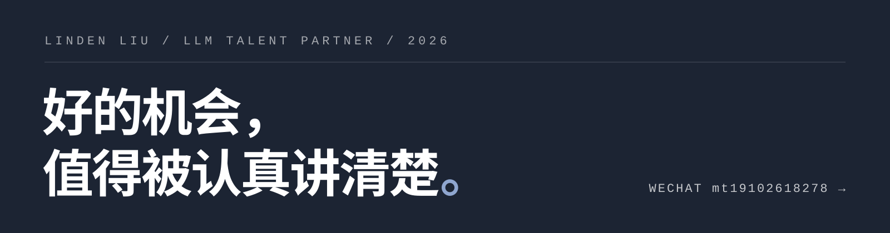

  

  

  
  
  

 

## 👋 关于我

我是 **Linden**，专注大模型领域的技术猎头。

和只盯一个细分方向不同，我同时跟进 **算法、AI Infra、数据、Agent、服务端** 多条线 —— 大模型行业变化快，好机会常常出现在方向交叉的地方，视野宽一点，才更容易帮你找到既对口、又有成长空间的位置。

推荐之前，我会认真看你的开源项目、论文和技术博客。**先弄懂你在做什么，再聊下一步去哪儿。**

 

## 🔥 正在帮这些团队找人

  
  
  
  
  

头部大模型团队、明星 AI 创业公司与量化机构都有合作，岗位从 **实习、校招到资深专家** 都有。

 

## 🧭 关注方向

  

> 如果你在做以上任何一个方向，我们大概率聊得来。

 

## 💼 我能为你做什么

<table>
  <tr>
    <td width="50%" valign="top">
      <h3>🙋 如果你是候选人</h3>
      <ul>
        <li>结合你的技术背景，匹配真正对口的岗位</li>
        <li>坦诚分享团队情况、面试流程与薪资行情</li>
        <li>全程保密，不施压，不乱推</li>
      </ul>
    </td>
    <td width="50%" valign="top">
      <h3>🏢 如果你是企业方</h3>
      <ul>
        <li>先吃透技术需求，再定向寻访</li>
        <li>覆盖开源社区、论文作者、竞赛选手等渠道</li>
        <li>同步人才市场动态与薪资水位</li>
      </ul>
    </td>
  </tr>
</table>

 

## 📬 联系我

  

  无论你在看机会，还是只想聊聊大模型行业动态，都欢迎加我微信（备注「GitHub」）。 
  <b>所有沟通严格保密。</b>

 

  

