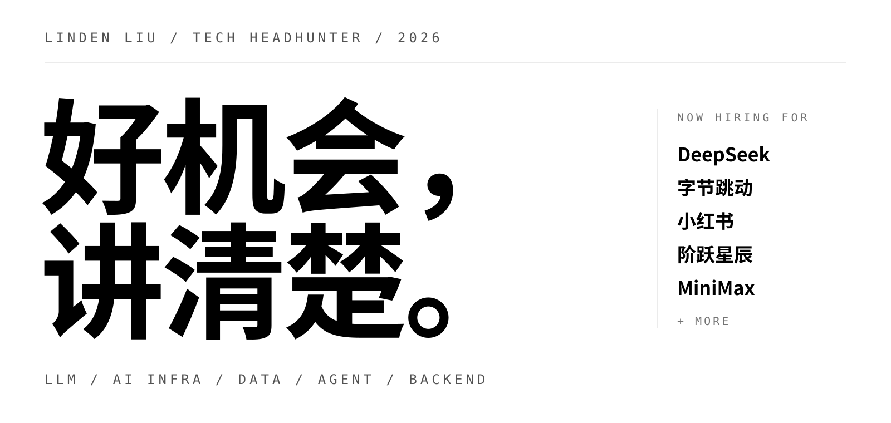

  

<table>
  <tr>
    <td width="70%" valign="top">
      
<strong>大模型方向技术猎头。</strong>

      
同时跟进算法、AI Infra、数据、Agent 与服务端多条线。大模型行业变化快，好机会常常出现在方向的交叉处——视野宽一点，才更容易找到既对口、又有成长空间的位置。

      
推荐之前，我会认真读你的开源项目、论文和技术博客。先弄懂你在做什么，再聊下一步去哪儿。

    </td>
    <td width="30%" valign="top">
      
WECHAT <strong>mt19102618278</strong>

      
添加请备注「GitHub」 所有沟通严格保密

    </td>
  </tr>
</table>

## 正在帮这些团队找人

| 团队 | 在招方向 | Base |
|---|---|---|
| **DeepSeek** | 预训练 / 后训练 / 多模态 / Frontier 研究员、训练与推理框架、算子 · 通信 · 编译器、分布式存储、服务端、Agent 弹性计算 | 北京 · 杭州 |
| **字节跳动** | Seed 大模型算法、豆包 / TRAE 等 AI 应用、火山方舟 MaaS、机器学习平台、算力基础设施 | 北京 · 上海 · 杭州 · 深圳 |
| **小红书** | 基础模型（预训练 / 后训练 / 多模态）、Agent 系统与基础设施、推理与训练框架、搜广推算法、AI 全栈 | 北京 · 上海 · 杭州 |
| **阶跃星辰** | 预训练 / Mid-train / 后训练 / RL、多模态、训推系统、Agentic 基础设施、数据平台 | 北京 · 上海 |
| **MiniMax** | 预训练 / 后训练 / Code、训练与推理框架、RL 系统、高性能网络与存储、MaaS 与开放平台、Agent 应用 | 北京 · 上海 |

以及深信服、多家 AI 创业公司与量化机构等。岗位从实习、校招到资深专家都有。

  
<strong>热招岗位举例</strong>（持续更新）

   

- **DeepSeek** — 服务端开发工程师、Agent 弹性计算研发工程师、预训练数据工程师、预训练 / 后训练研究员
- **字节跳动** — Seed 大模型算法、豆包 / TRAE 应用研发、火山方舟推理服务、机器学习平台
- **小红书** — 基础模型算法（Dots / AllSpark）、Agent 系统架构与基础设施、大模型推理与训练框架、GPU 调度
- **阶跃星辰** — Pre-train / Post-train 算法研究员、后训练系统工程师、推理优化系统、Agentic 基础设施
- **MiniMax** — 推理框架工程师、大模型训练系统专家、RL 框架 & RL 推理、大模型高性能网关、AI Infra 资源调度

## 关注方向

- **大模型算法** — 预训练 · 后训练 · RL · 多模态理解 · Frontier 研究 · 评测
- **AI Infra** — 训练 / 推理框架 · 高性能算子 · 通信 · 编译器 · 分布式存储 · 集群调度
- **数据** — 预训练数据工程 · 采集 / 清洗 / 去重 · 数据平台 · 数据湖
- **Agent** — Agent 框架 · Code Agent · 弹性计算 · 沙箱与 RL 环境
- **服务端开发** — 后端 · 分布式系统 · 研发效率基建 · API 与线上服务 · 全栈

## 我能帮你什么

- **找方向** — 按你的技术栈和意向推荐，不乱推，不广撒网
- **讲清楚** — 团队在做什么、面试流程、薪资行情，如实说
- **做准备** — 面试前一起梳理项目经历，把你的亮点讲出来
- **守边界** — 全程保密，不施压；看机会或只是聊聊都可以

企业方：先吃透技术需求再定向寻访，覆盖开源社区、论文作者与竞赛选手。

## 找到我

**Linden Liu** — 微信 `mt19102618278`（添加请备注「GitHub」）

  

